# SSL Studio UI Design Document

**Status:** Phase 1 + Phase 1.5 (C1–C13) Implemented & Verified (2026-11-21).
**Governance:** [ADR 0002](adr/0002-text-is-the-source-of-truth.md), [ADR 0007](adr/0007-design-is-held-to-a-standard-that-serves-starlims-work.md), [ADR 0008](adr/0008-a-table-in-documentation-has-at-most-four-columns.md), [ADR 0009](adr/0009-nothing-is-lost-or-destroyed-without-a-say.md), [ADR 0010](adr/0010-everything-works-from-the-keyboard.md), [ADR 0020](adr/0020-the-shell-does-what-vs-code-does-and-stays-its-own.md), [ADR 0023](adr/0023-the-windows-graphics-and-menus-are-its-own.md).

This document is the single authoritative specification for SSL Studio's interface overhaul. Part I records the verified pre-overhaul walkthrough, Parts II–IV lock the Folio Bento + OKLCH Warm Material target and adversarial review, and Section 13 records the locked Phase 1.5 refinements (C1–C13) from live hands-on review.

---

## Part I — Current Interface Walkthrough (Baseline)

Every observation and screenshot below was captured directly from the unmodified running application (`bun src/bun/web.ts`) opened on an isolated copy of the public demo project (`examples/due-dates`) with the pinned bundled language server (`starlims-lsp 0.31.0`) active. Viewports were measured at desktop wide (`1440×900`) in Studio Dark and Studio Light, and desktop narrow (`740×760`) in Studio Dark.

### 1. Current Shell Architecture, Tokens & Accessibility Baseline

SSL Studio's current UI (`src/view/App.tsx`, `src/view/style.css`, `src/view/layout.ts`, `src/view/themes/themes.ts`) implements a clean, VS Code-familiar workbench:

| Property | Current value | Detail |
| --- | --- | --- |
| Grid layout | 6 cols × 3 rows | Menu bar, Activity rail, Left, Splitter, Center, Splitter, Right, Status bar |
| Fixed bar heights | `28 / 33 / 24 px` | Menubar `28px`, Tab strip `33px`, Status bar `24px`, Rail `44px` (× `--ui-scale`) |
| Splitters | `4px` solid | Uses `--border`, widens hit area away from editor edge (`style.css:127-136`) |
| Typography | `system-ui` | Pure sans-serif (`10–18px` × `--ui-scale`); `13px` monospace code; zero serif |
| Icons | Codicon font | Monaco's bundled `codicon` across all controls and `FileMark` (ADR 0023) |
| Themes | 2 built-in + JSON | `studio-dark.json`, `studio-light.json`, 24 mapped tokens, VS Code JSON import |
| Crowding floor | `360px` center | `layout.ts`: `CENTER_WANTED = 480`, `CENTER_MIN = 360`, `LEFT = 160`, `RIGHT = 220` |
| Contrast gate | WCAG 2.1 AA | `test/contrast.test.ts`: `>= 4.5:1` text on all 7 surfaces, `>= 3.0:1` edges |

Current color tokens (`studio-dark.json` / `studio-light.json`):

| Token role | Studio Dark | Studio Light | Notes |
| --- | --- | --- | --- |
| Editor ground | `#1b1d23` | `#fbfbfc` | Cool dark slate vs near-white light |
| Side / Panel ground | `#191b20` | `#f3f4f6` | Only 2 lightness steps from dark editor |
| Status / Rail / Menu | `#15171b` | `#e9ebef` | Cool neutral outer frame |
| Hairline border | `#262931` | `#e1e4e8` | Used on 4px splitters and every divider |
| Accent / Focus | `#c792ea` | `#7a36ed` | Lavender-purple dark, vivid violet light |
| Primary button | `#7c5cbf` | `#6d28d9` | White text foreground |

**Existing accessibility strengths that MUST NOT regress (ADR 0010):**

- Non-color visual cues throughout: dashed/dotted/dash-dot edges in Call Graph (`style.css:752-756`), corner status shapes in Planning Mode (`style.css:843-849`), ringed active dots in narrow Docs (`style.css:1001-1002`), strike/underline in Search replace (`style.css:265-267`), letters beside colors in Git (`style.css:167-171`), and a broken/dashed bar for modified git gutter marks (`style.css:146-151`).
- Minimum `24px × 24px` (`--target`) pointer hit areas, `2px` focus rings (`--accent`), `prefers-reduced-motion: reduce` opt-outs, and full keyboard navigation (`Rows.tsx`, `QuickPick.tsx`, `GraphView.tsx`, `PlanView.tsx`, `BlocksView.tsx`).

### 2. Complete Panel & Overlay Inventory (Nothing May Be Lost)

`src/view/panels/registry.ts` defines **10 dockable side panels** (each freely movable between left and right sides), plus center modes, bottom tabs, and modal dialogs:

| Panel or surface | Default dock | Capabilities |
| --- | --- | --- |
| Explorer | Left rail | File tree, new file/folder, refresh, drag/move/cut/paste, row menu, `FileMark` |
| Docs | Left rail | Project, Work (tickets + nested plans/specs), Knowledge Base, Registries, Schema |
| Objects | Left rail | Regions with color swatches (`cycleRegionColor`), procedures, cursor tracking |
| Palette | Left rail | SSL templates + kept project snippets with live code preview (`36%` height) |
| Reference | Left rail | Searchable STARLIMS built-in functions, classes, keywords + rendered Markdown |
| Search | Left rail | Workspace text search + regex/case/word toggles + inline replace preview |
| Source Control | Left rail | Branch, commit box (`Ctrl+Enter`), stage/unstage/discard, Git Compare diff |
| Local History | Left rail | Per-file save timeline snapshots opening into `ReviewView` restore diff |
| Health | Left (movable) | 6 sections: Project, Work checks, Registries, Size limits, Procedures, Findings |
| Agent | Right (movable) | `opencode` status, local model selector, 6-step `Tidy`, starters, kept prompts |
| Call Graph | Center view | ELK script/folder graph, `Graph \| List`, filter, finder, minimap, PNG/SVG save |
| Problems / Output | Bottom panel | File-grouped diagnostics with severity tallies and 2-line wrap; timestamped log |
| Review / Compare | Center view | Monaco diff for Agent/History Accept/Reject (with checks) or read-only Git diff |
| Overlays | Modal | `QuickPick`, `RowMenu`, `SettingsDialog`, `StyleProfile`, `Dialogs`, `Toasts` |

### 3. Screen-by-Screen Live Walkthrough

#### 3.1 Start Screen (`1440×900`, Studio Dark)

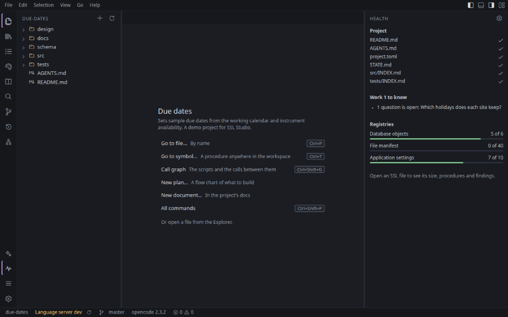

- **What exists (`Start.tsx`, `App.tsx`, `MenuBar.tsx`):** Clean project landing page (`Due dates`) inside the empty editor group showing six keyboard-backed entry points (`Go to file… Ctrl+P`, `Go to symbol… Ctrl+T`, `Call graph Ctrl+Shift+G`, `New plan…`, `New document…`, `All commands Ctrl+Shift+P`). Top-right layout controls show Left, Bottom, Right, and Customize buttons. Right-docked icons (`Agent`, `Health`) appear at the bottom of the left Activity Bar.
- **What is missing:** Once a workspace is open, there is no one-click way to toggle back to the no-folder `Welcome.tsx` recent-projects switcher without closing the folder via the File menu.

#### 3.2 Code Editor — Wide (`1440×900`, Studio Dark & Studio Light)

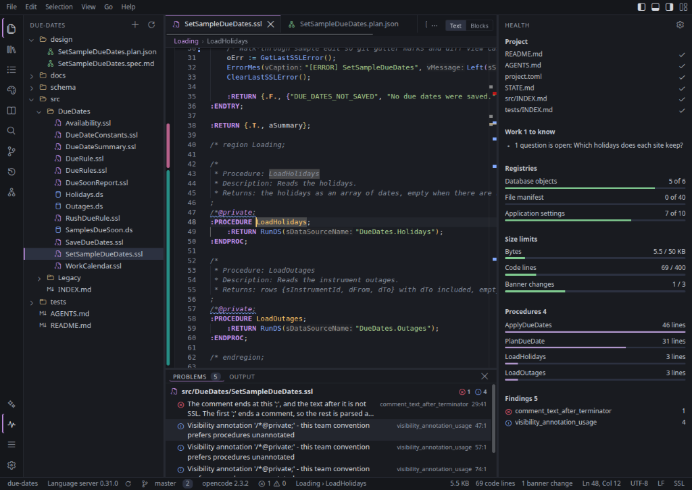

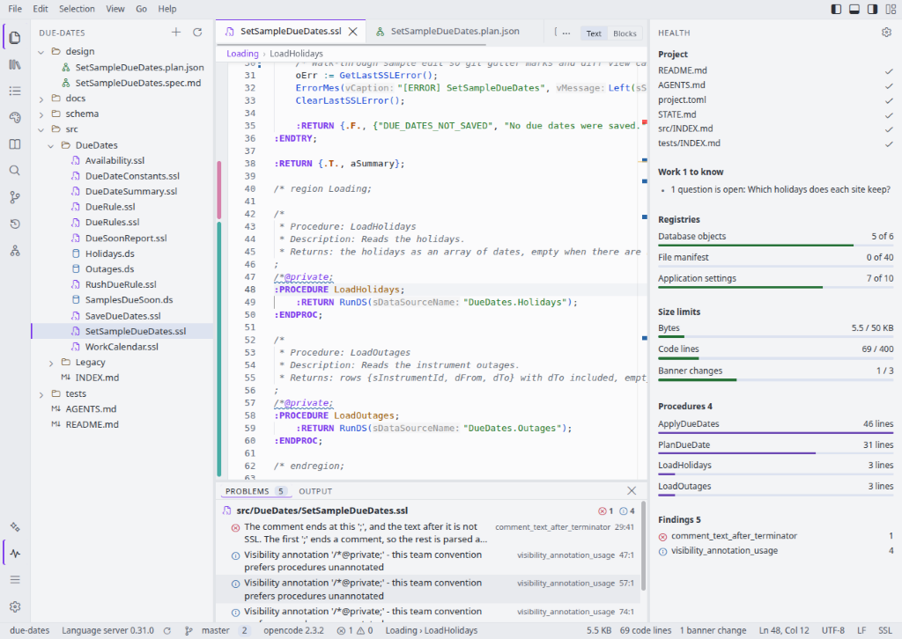

- **What exists (`EditorGroup.tsx`, `regions.ts`, `gitMarks.ts`, `Problems.tsx`, `Health.tsx`, `StatusBar.tsx`):**
  - Monaco editor with live `starlims-lsp 0.31.0` semantic highlighting, inline parameter hints (`sDataSourceName:`), squiggles, and overview ruler markers.
  - `22px` interactive breadcrumb bar (`Loading › LoadHolidays`).
  - **`18px` SSL Region Strip** at the left edge of the editor canvas showing nested clickable colored vertical bands (`Loading`, `Due dates`) from `REGION_PALETTE`.
  - Git gutter marks (`added` green bar, `modified` broken blue bar, `removed` red edge tick).
  - Bottom `Problems 5` panel grouped by file (`src/DueDates/SetSampleDueDates.ssl`, `⊗ 1 ⓘ 4`), showing 2-line readable messages, rule codes (`comment_text_after_terminator`), and `line:col`.
  - Right `Health` panel showing all 6 live sections (`Project`, `Work 1 to know`, `Registries` progress bars, `Size limits` bytes/lines/banner bars, `Procedures 4` proportional length bars, `Findings 5` by rule).
  - `StatusBar` showing 12 distinct live facts: workspace, LSP version + restart, git branch + changed count, `opencode` version, diagnostic counts, symbol breadcrumb, file bytes, SSL code lines, banner changes, `Ln/Col`, encoding, EOL, language.
- **Observed visual defects:**
  - Low surface elevation between `#15171b`, `#16181d`, `#191b20`, and `#1b1d23` in Studio Dark; stark `#fbfbfc` glare in Studio Light.
  - Heavy `4px` solid gray splitter bars cut across the window.
  - Right-docked panel buttons (`Agent`, `Health`) sit at the bottom of the left Activity Bar, visually disconnected from the right panel they toggle.
  - In `Problems`, severity icons sit inline inside flex rows whose spacing subtly shifts across error vs info symbols relative to the first word of the message.

#### 3.3 Code Editor — Narrow Layout (`740×760`, Studio Dark)

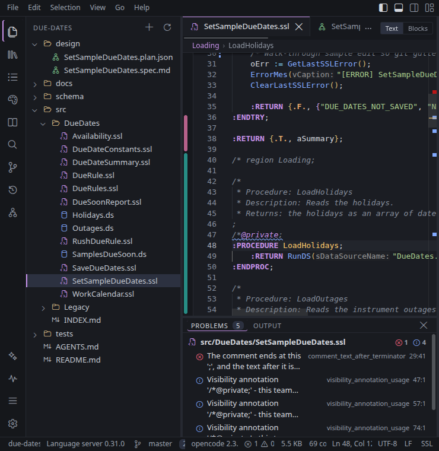

- **What works:** `layout.ts` (`fitPanels`) cleanly hides the right panel (`Health`) so the editor preserves its `360px` minimum width while `Explorer` and `Problems` remain usable.
- **Observed verified defects:**
  1. **Status bar clips mid-character:** At `740px` width, status bar items compress until text is physically sliced: `master 2` clips the `2`, `opencode 2.3.` drops the final digit, `69 co` slices `code lines`, and `Ln 48, Col 1:` clips `12`.
  2. **Tab truncation:** With just two tabs open alongside `Text | Blocks`, `SetSampleDueDates.plan.json` collapses to `SetSam…`.
  3. **Right-panel crowding behavior:** Clicking `Health` or `Agent` in a narrow window swaps sides (`lastShown`), which works functionally, but visually hides the left panel rather than offering a unified left-slot drawer with clear dock indication.

#### 3.4 Blocks View (`1440×900`, Studio Dark)

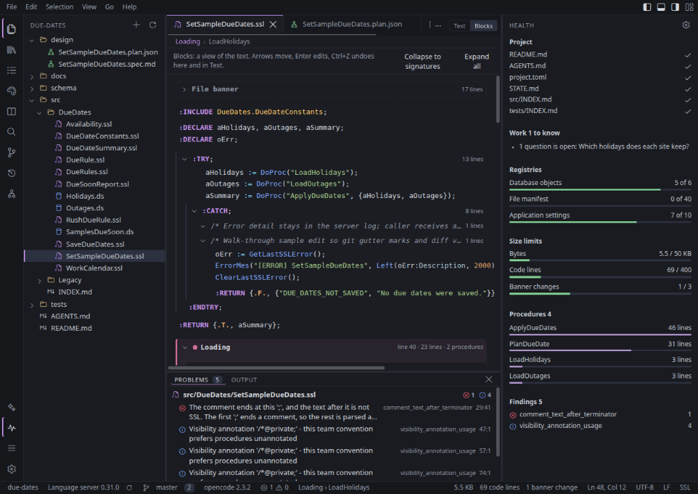

- **What exists (`BlocksView.tsx`):** A faithful structural projection of `SetSampleDueDates.ssl` backed by `ssl/syntaxTree` and Monaco `colorize`: collapsed `File banner (17 lines)`, top-level `:INCLUDE` / `:DECLARE`, nested `:TRY (13 lines)` / `:CATCH (8 lines)` with collapsible comments, and collapsed `Loading` region card (`line 40 · 23 lines · 2 procedures`) with its region color mark. Single undo stack shared with Text mode (ADR 0002).
- **Observed verified defect:** At `1440px` 3-pane width, `.blocks-bar` squeezes `Collapse to signatures` and `Expand all` so both buttons wrap awkwardly onto two lines beside the verbose helper sentence.

#### 3.5 Planning Mode (`1440×900`, Studio Dark)

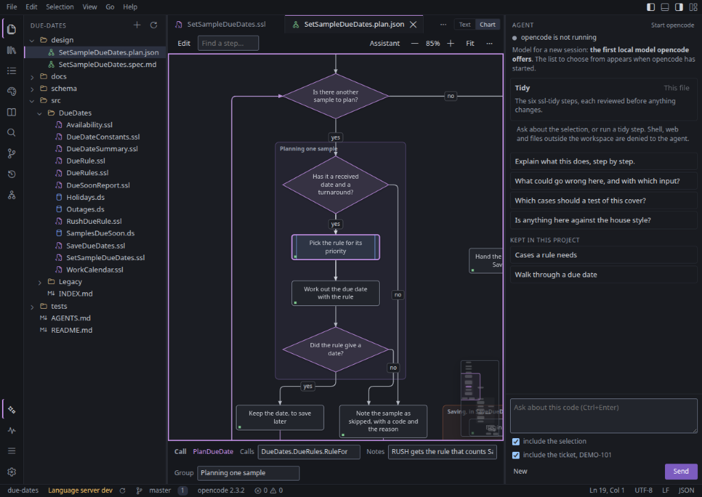

- **What exists (`PlanView.tsx`, `PlanAssistant.tsx`):** ELK-laid-out business-analyst flowchart of `examples/due-dates/design/SetSampleDueDates.plan.json` with plain-English node labels (`Has it a received date and a turnaround?`, `Pick the rule for its priority`, `Work out the due date with the rule`), stage grouping (`Planning one sample`), green built-state corner dots, interactive zoom/fit/finder toolbar, minimap, `Text | Chart` tab-strip switch, and right-hand `Agent` panel (`Tidy`, starter prompts, `KEPT IN THIS PROJECT`, context checkboxes `include the selection` and `include the ticket, DEMO-101`).
- **Observed verified defects:**
  1. **Bottom `.plan-details` bar clips and wraps:** `Notes` input text truncates mid-word (`RUSH gets the rule that counts Sa`) at the right edge while `Group` wraps onto a second row below `Call / Calls / Notes`.
  2. **Node-creation controls live inside an `Edit` dropdown** instead of taking advantage of the left `Palette` panel for discoverable process shapes.

#### 3.6 Call Graph (`1440×900`, Studio Dark)

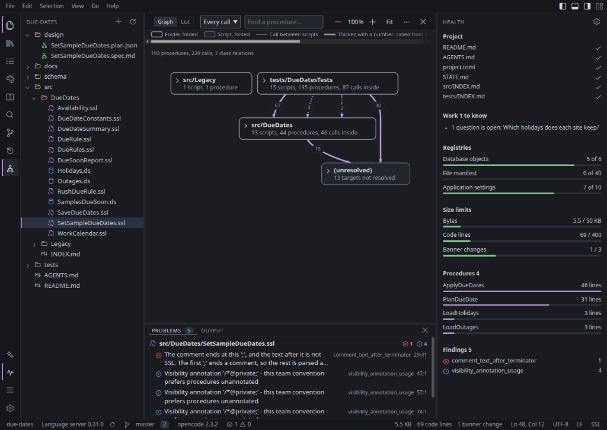

- **What exists (`GraphView.tsx`):** Workspace-wide call graph (`193 procedures, 239 calls, 7 class relations`) using ELK layout with folded folder nodes (`src/Legacy`, `tests/DueDatesTests`, `src/DueDates`, `(unresolved)`), directed weighted arrows (`67`, `4`, `2`, `30`, `15`), blue dashed/dotted class-relation lines, `Graph | List` toggle, scope filter (`Every call`), procedure finder, zoom/fit controls, minimap, and hover call-lighting.
- **Observed verified defects:**
  1. **Document tab strip disappears completely:** `App.tsx:293-295` renders `<GraphView />` in place of `<EditorGroup />`, hiding all open file tabs.
  2. **Legend bar overflows horizontally:** Under `720px` container width (`style.css:638-642`), `.graph-legend` turns into a clipped horizontally scrolling row (`Thicker, with a number: called from th…`) with an awkward thin scrollbar.
  3. **Bottom `Problems` panel stays open by default**, consuming ~180px of vertical canvas height when inspecting architecture rather than editing code.
  4. **Activity Bar mismatch:** Call Graph is highlighted in the left rail while `Explorer` remains open in the left sidebar.

#### 3.7 Working Docs (`1440×900`, Studio Dark)

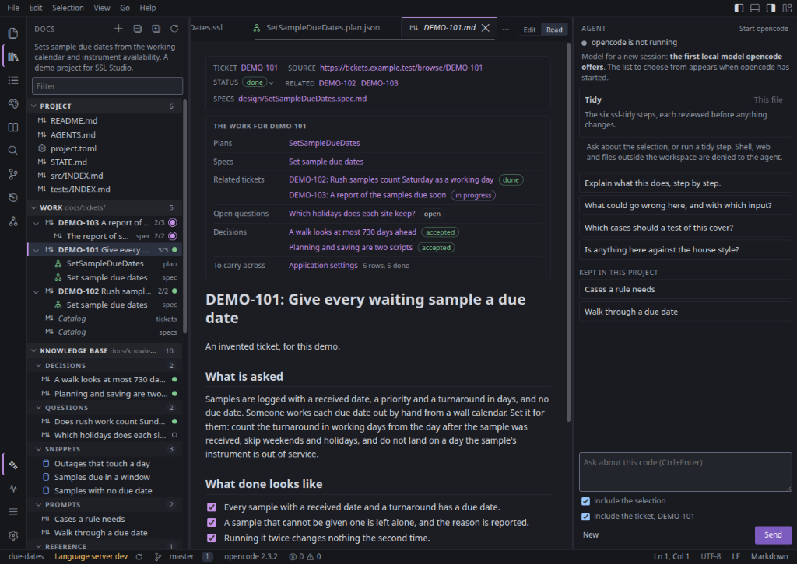

- **What exists (`Docs.tsx`, `MarkdownView.tsx`):** Rich left `Docs` panel (`+`, `Collapse all`, `Expand all`, `Refresh`, `Filter`, collapsible `PROJECT`, `WORK` with nested plan/spec under each ticket and `3/3` task tallies, `KNOWLEDGE BASE`, `REGISTRIES`, `DOCS`, `SCHEMA`). Center `Read` view renders YAML front-matter metadata (`TICKET`, `SOURCE`, `STATUS` dropdown, `RELATED`, `SPECS`), `THE WORK FOR DEMO-101` cross-reference card, rendered Markdown with clickable task checkboxes, and `Linked from` backlinks. Tab strip holds `Edit | Read`.
- **Observed verified defects:**
  1. **Tab bar crowding:** With 3 tabs open in a 3-pane `1440px` window, the leftmost tab clips off (`Dates.ssl`).
  2. **`On this page` outline is trapped in a catch-22 (`style.css:1093-1094`):** Hidden completely whenever the Markdown container is `< 1000px` (so invisible in normal 3-pane desktop view!), yet when visible above `1000px`, it steals `220px` directly out of the reading column.

#### 3.8 Table View (`1440×900`, Studio Dark)

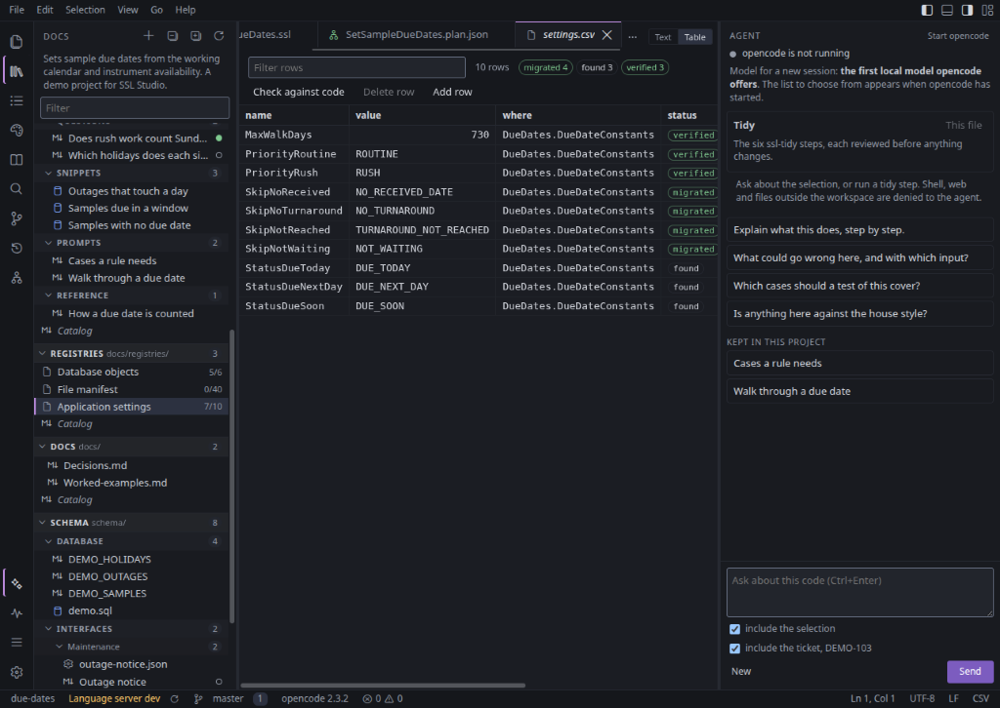

- **What exists (`TableView.tsx`):** Structured CSV/TSV editor on `examples/due-dates/docs/registries/settings.csv` backed by plain text (ADR 0002): `Filter rows`, `10 rows` tally, clickable status filter chips (`migrated 4`, `found 3`, `verified 3`), `Check against code`, `Delete row`, `Add row`, sortable sticky column headers, inline cell editing, and clickable ticket links. Tab strip holds `Text | Table`.
- **Observed verified defects:**
  1. **Toolbar wraps onto two rows** in a 3-pane `1440px` layout (`Check against code`, `Delete row`, `Add row` drop below `Filter rows` + status chips).
  2. **Horizontal overflow without sticky key column:** Rightmost columns (`ticket`, `note`) scroll off-screen; scrolling right loses sight of the `name` key column.

#### 3.9 Source Control & Git Compare (`1440×900`, Studio Dark)

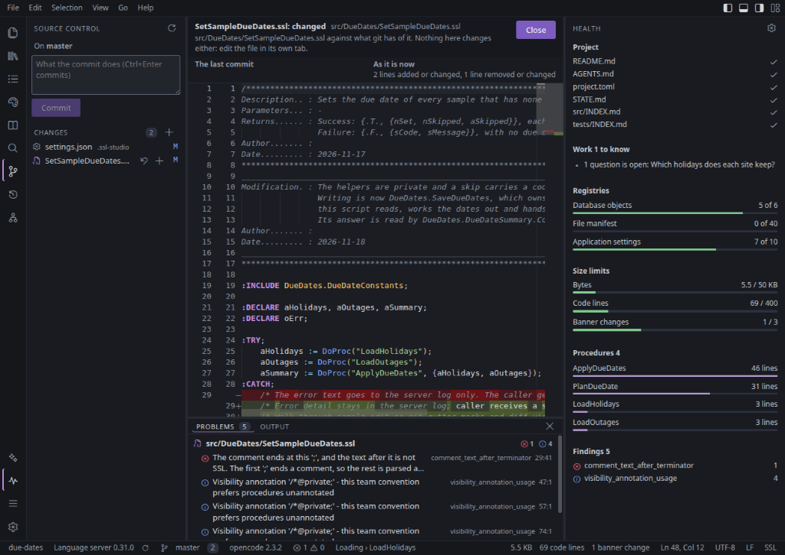

- **What exists (`Git.tsx`, `Review.tsx`):** Clean VS Code-style Source Control sidebar (`On master`, commit textarea with `Ctrl+Enter`, `Commit` button, `CHANGES 2` list with `M` letters and hover stage/discard buttons). Clicking a changed file opens `ReviewView` with Monaco diff (`SetSampleDueDates.ssl: changed`, line-change summary, `Close` button; Agent proposals and History restores show `Accept`, `Reject`, `Check[]` list, agent note, and editable right side).
- **Observed verified bugs:**
  1. **Document tab strip disappears completely:** `App.tsx:297-299` replaces `<EditorGroup />` with `<ReviewView />`, hiding open tabs.
  2. **Mismatched 2-column header over 1-column inline diff:** `Review.tsx:88` sets `renderSideBySide: true`, but Monaco automatically collapses to inline mode below `900px` width (every 3-pane `1440px` layout!) while `.diff-sides` still prints `The last commit` and `As it is now` side-by-side over an inline unified diff.
  3. **No user choice of diff layout:** Users cannot explicitly switch between Side-by-Side, Inline, or Hunk review layouts.

#### 3.10 Health Panel & Lower Docs Tree (`1440×900`, Studio Dark)

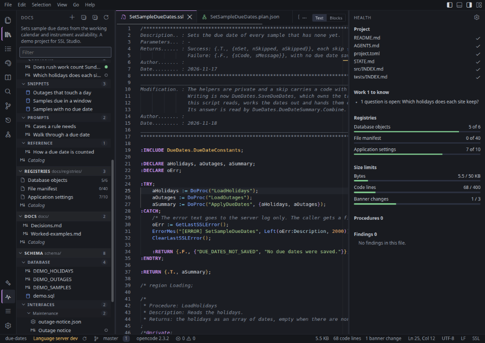

- **What exists (`Health.tsx`, `Docs.tsx`):** Shows the lower half of the `Docs` sidebar (`SNIPPETS`, `PROMPTS`, `REFERENCE`, `REGISTRIES`, `DOCS`, `SCHEMA > DATABASE / INTERFACES`) alongside the full 17-line STARLIMS file banner and `Health` (`Project`, `Work`, `Registries`, `Size limits`). Captured prior to LSP activation (`Procedures 0 / Findings 0` fallback); compare with `02-code-dark-wide.png` for live LSP-populated `Procedures 4 / Findings 5`.

#### 3.11 Settings Modal (`1440×900`, Studio Dark)

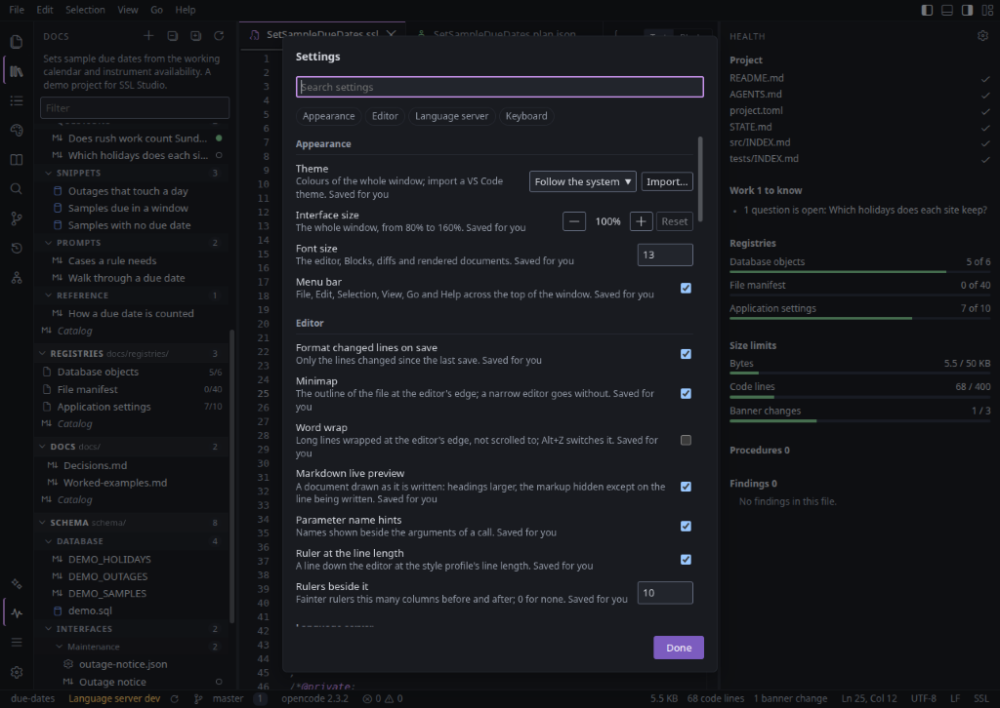

- **What exists (`Settings.tsx`):** Centered modal (`max-width: 560px`) with `Search settings`, section jump pills (`Appearance`, `Editor`, `Language server`, `Keyboard`, `Editor keys`, `Markdown keys`), sticky section headers, Theme dropdown + `Import…` button for VS Code themes, `Interface size` stepper (`80%–160%`), `Font size`, and editor toggles. Clean, well-structured, and keyboard-accessible — the OKLCH Tone × Material selector slots naturally into the `Appearance` section alongside `Import…`.

### 4. Summary of Baseline Defects That Justify Changes

Every UI change in Part II must trace back to either a **verified baseline defect** below or a **confirmed user goal**:

| ID | Evidence | Baseline issue |
| --- | --- | --- |
| B1 | `02` / `03` shots | Flat dark hierarchy and stark light glare |
| B2 | `02` (`style.css`) | Heavy `4px` solid gray splitters across the window |
| B3 | `04-narrow` shot | Mid-character status bar clipping at `740px` width |
| B4 | `07` / `10` shots | Document tabs vanish in Call Graph and Diff Review |
| B5 | `01` / `02` shots | Right-docked icons sit at bottom of left Activity Bar |
| B6 | `05`, `06`, `09` | Blocks, Plan Details, and Table toolbars wrap or clip |
| B7 | `07-graph` shot | Call Graph legend overflows with horizontal scrollbar |
| B8 | `07-graph` shot | Problems stays open in Graph, Plan, Docs, and Table |
| B9 | `02` (`Problems`) | Problems severity icon and text optical misalignment |
| B10 | `08` (`style.css`) | `On this page` hides `<1000px` and steals prose `>=1000px` |
| B11 | `10` (`Review.tsx`) | `.diff-sides` 2-column header over 1-column inline diff |
| B12 | `01-start` shot | No quick toggle to Welcome/Projects switcher |
| B13 | `09-table` shot | Table view loses key column during horizontal scroll |

---

## Part II — Design Evolution & Locked Target Specification

### 5. Chronological Decision Trail & Prototype Drift Audit

The target design ("Folio Bento" + OKLCH Warm Material) evolved through six deliberate selection rounds:

1. **Rounds 1–2 (`options` → `round2`):** Selected **Warm Editorial × OKLCH Matrix** and **Variant D (Framed Workbench)** geometry — warm tactile elevation instead of flat binary dark/light slabs.
2. **Rounds 3–5 (`round3` → `round5-wild`):** Selected **Bento Islands** (`5px` gutters, `7px` corners, quiet section boundaries) merged with **Editorial Folio's** calm central sheet and tucked tabs; rejected website-like high-contrast experiments (Neo-Tokyo, Blueprint) as distracting for daily STARLIMS development.
3. **Synthesis (`ui-overhaul-synthesis.html`):** User locked four shell choices: **Tucked Folio tabs**, **Scroll-collapsing Folio header**, **Classic Left Rail**, and **Clean Border** (no left accent book-spine).
4. **Final Baseline (`ui-overhaul-final.html`):** Locked the OKLCH `5 Tones × 5 Materials` palette engine and fixed four user-requested details: Explorer hide/show toggle, SSL Region Strip restored, silky single-DOM scroll collapse with hysteresis, and balanced `18px`-track Problems grid.
5. **Mode Revisions (`modes` → `modes-v3`):** Expanded the spec to Call Graph, Planning Mode, Working Docs, Table View, Diff Review, and Welcome/Projects.

#### Regressions & Drift Caught Across Prototypes (Explicitly Reverted Here)

Auditing the HTML mockups against the live baseline revealed **10 concrete regressions** that crept in during rapid prototyping. Every one is explicitly called out and locked out of the specification:

| Mockup drift | Where | Resolution |
| --- | --- | --- |
| `Georgia` serif UI | `synthesis..v3` | **Reverted.** Keep pure `system-ui` sans-serif across all chrome |
| Custom SVG icons | `synthesis..v3` | **Reverted.** Keep Codicon (`Icon.tsx`) and `FileMark` (ADR 0023) |
| Dropped tab marks | `final`, `modes-v3` | **Reverted.** Tucked Folio tabs keep `×`, pin, `FileMark`, dirty dot |
| Dropped 6 panels | `final` (7 icons) | **Reverted.** All 10 panels, Call Graph, and Commands stay reachable |
| Dropped size meters | `final` footer | **Reverted.** Keep bytes/lines/banner meters with narrow tiers |
| Flattened Problems | `final` bottom | **Reverted.** Keep file grouping and 2-line wrap; fix icon grid only |
| Moved view switch | `final`, `v1`/`v2` | **Reverted.** Permanently locked to tab-strip right end |
| Invented table col | `modes-v2` table | **Reverted.** Keep real `TableView.tsx` columns and code check |
| Filler subtitles | `modes-v1`/`v2` | **Reverted.** Zero filler prose under titles or empty bands |
| OKLCH curve drift | `modes-v3` vs `final` | **Reverted.** Frozen verbatim to `ui-overhaul-final.html` curves |

### 6. Canonical Shell Geometry ("Folio Bento")

All dimensions scale proportionally with `--ui-scale` (`Settings > Interface size`, `80%–160%`) and collapse tray padding cleanly at narrow widths (`<= 780px`) so code never loses space (ADR 0007):

| Region | Locked spec | Behavior |
| --- | --- | --- |
| Outer tray | `--tray-bg`, `5px` | Recessed workbench frame; collapses to `0px` gutter at `<= 780px` |
| Islands | `7px` radius, `1px` | Side, Editor, Bottom, Right sheets with `--border`; no book-spine |
| Top bar | `34px` unified | Projects switcher, 6 menus, recessed Command Center, 3 panel toggles |
| Left rail | `42px` classic | Left-docked panels, Call Graph, bottom divider for narrow right panels |
| Gap splitters | `5px` gap slot | Invisible at rest; `2px` accent pill on hover/focus; spares editor edge |
| Tab strip | `33px` Tucked Folio | Always visible in all modes; merges cleanly into active sheet top edge |
| View switch | Tab-strip right end | `•••` menu + `Text \| Blocks`, `Text \| Chart`, `Source \| Live \| Read`, `Text \| Table` |
| Bottom panel | Framed island | Default open in Code; default hidden in all other modes; per-mode state |
| Status footer | `24px` tray-integrated | Keeps all 12 real items; 3 responsive priority tiers prevent clipping |

#### Responsive Status Footer Tiers (Fixes Verified Defect B3)

Instead of letting flexbox slice characters mid-word at `740px` (`04-code-narrow-740-dark.png`), status bar items hide cleanly in deterministic priority order:

| Priority tier | Breakpoint | Items |
| --- | --- | --- |
| Tier 1 (Always) | All widths | Branch + dirty count, LSP dot/status, Error/Warn counts, `Ln/Col`, Kind |
| Tier 2 (Medium) | `<= 960px` | Breadcrumb path (already in header/Objects), `opencode` version string |
| Tier 3 (Narrow) | `<= 780px` | Workspace name (in Top Bar), encoding (`UTF-8`), EOL (`LF`), banner tally |
| Alert override | Always shown | Size-limit meters (`bytes`, `code lines`, `banner`) reappear if `near`/`over` |

#### Narrow Layout Access for Right-Docked Panels

When `fitPanels()` in `src/view/layout.ts` crowds out the right sidebar (window width `< left + right + 360px + rail`):

1. The right island closes cleanly so the editor keeps at least `360px`.
2. Right-docked panel buttons (`Agent`, `Document Outline`, or any panel moved right) appear below a subtle `1px` horizontal divider in the left rail.
3. Clicking a right-docked icon opens that panel inside the **left island slot** with a quiet `Right` dock badge in its header (clicking the badge or using the menu still moves it permanently).

#### Motion Policy

- **Zero bouncy UI elements:** Never use `translateY` hover lifts, scale pops, or spring overshoot curves.
- Permitted transitions are subtle `110–140ms ease` color/border/opacity fades and the `240ms cubic-bezier(0.22, 1, 0.36, 1)` scroll-collapsing header (`grid-template-rows` + opacity).
- All transitions disable completely under `@media (prefers-reduced-motion: reduce)`.

### 7. Canonical Color & Typography System (OKLCH Warm Material)

#### Typography (System Default + User-Configurable Font Slots)

- **Locked baseline default:** Pure `system-ui, -apple-system, "Segoe UI", sans-serif` across all IDE chrome, tabs, Folio headers, panels, and mode toolbars (`--ui-font`), paired with `ui-monospace, "Cascadia Code", Menlo, Consolas, monospace` for code, Blocks, Tables, and Output (`--code-font`). Zero serif drift at startup.
- **Icons:** Monaco's bundled `codicon` icon font via `Icon.tsx` and `FileMark.tsx` (ADR 0023).
- **Extensible font architecture (`Settings > Appearance`):** Wire typography cleanly through three CSS custom properties (`--ui-font`, `--code-font`, `--read-font`) saved alongside Theme so users can keep `System default`, pick a curated house preset, or enter any installed local font:

| Slot | Default | Role | House candidates |
| --- | --- | --- | --- |
| `--ui-font` | `system-ui` | Chrome & panels | `IBM Plex Sans`, `Inter` (clean tabular digits for dense lists) |
| `--code-font` | `ui-monospace` | Code & tables | `JetBrains Mono`, `IBM Plex Mono` (clear `;`, `:`, `:=`, `/*` in SSL) |
| `--read-font` | Inherit UI | Markdown Read | `Source Serif 4`, `Newsreader` (opt-in reading face, never chrome) |

*(All house font candidates are SIL OFL open-licensed for safe inclusion in a public repository if bundled later; Stage 1 ships `System` default + custom font-family selectors in Settings without adding binary font weight yet.)*

#### Frozen OKLCH Surface Tones (5 Stops — Verbatim from `ui-overhaul-final.html`)

`Other stops` lists lightness `L` for `panel / hl / bdr / inp / hov / sel`:

| Tone | Polarity | `tray / side / ed` | Other stops |
| --- | --- | --- | --- |
| Paper | Light | `.904 / .942 / .975` | `.946 / .944 / .848 / .985 / .896 / .866` |
| Stone | Mid-light | `.832 / .876 / .916` | `.880 / .882 / .775 / .942 / .834 / .798` |
| Split Warm | Mixed | `.146 / .186 / .972*` | Chrome dark (`.186/.285`); Editor light paper (`H=76, C=.013`) |
| Slate Dusk | Mid-dark | `.200 / .240 / .280` | `.244 / .318 / .346 / .218 / .286 / .328` |
| Obsidian | Deep dark | `.134 / .174 / .214` | `.178 / .252 / .278 / .150 / .222 / .266` |

*\*In `Split Warm`, chrome uses dark lightness curves (`tray .146`, `side .186`, `panel .186`, `bdr .285`, `inp .160`, `hov .232`, `sel .274`) while the editor canvas uses warm light paper (`ed .972`, `hl .944`, `editorBorder .862`, `editorStripBg .955`, `H=76`, `C=0.013`).*

#### Frozen OKLCH Material Hues (5 Finishes — Verbatim from `ui-overhaul-final.html`)

| Material | Base `H / C` | Accent `H / C` | Character |
| --- | --- | --- | --- |
| Walnut | `66° / 0.014` | `50° / 0.13` | Warm sandstone chrome with copper-amber accent |
| Moss | `142° / 0.013` | `148° / 0.11` | Quiet botanical charcoal-sage with forest green accent |
| Clay | `46° / 0.014` | `30° / 0.14` | Warm taupe editorial base with terracotta accent |
| Steel | `235° / 0.013` | `242° / 0.13` | Architectural cool slate with precision cobalt accent |
| Veridian | `175° / 0.012` | `176° / 0.11` | Cool clinical teal-slate with veridian accent |

#### WCAG 2.1 AA Contract & Split Warm Token Decoupling

`safeFg(L, C, H, bg, target)` steps OKLCH lightness (`±0.015`) until WCAG contrast is guaranteed:

- Body text: `>= 7.5:1` on chrome (`--side-fg`), `>= 10.5:1` on editor (`--editor-fg`).
- Strong/active labels: `>= 10.2:1` on chrome, `>= 11.5:1` on editor.
- Muted labels, accent text, and semantic colors (`--ok` `H=148`, `--warning` `H=78`, `--error` `H=22`, `--info` `H=245`): `>= 4.65:1` (exceeding WCAG AA `4.5:1`).
- Control edges (`--input-border`, focus border): `>= 3.1:1` (exceeding WCAG `3.0:1`).
- Syntax tokens (`kw`, `fn`, `str`, `num`, `com`, `param`, `method`): verified `>= 4.55:1` against **both** `--editor-bg` and `--editor-line-hl`.
- **Critical Split Warm engineering rule:** Because a single hex color cannot simultaneously achieve `>= 4.5:1` against both dark espresso chrome (`#151210`) and warm light paper (`#fbf8f3`), `themes.ts` MUST emit separate editor-scoped tokens (`--editor-bg`, `--editor-fg`, `--editor-muted`, `--editor-accent`, `--editor-border`, `--editor-ok`, `--editor-warning`, `--editor-error`, `--editor-info`) alongside chrome-scoped tokens. `test/contrast.test.ts` must verify all 25 generated Tone × Material themes (checking chrome tokens against chrome surfaces and editor tokens against editor surfaces).
- **Theme compatibility:** Keep `Studio Dark (Classic)` and `Studio Light (Classic)` available, preserve VS Code `.json` theme import (`themes.ts`), and map `Follow the system` to user-chosen light/dark stops (default: `Paper · Walnut` light, `Slate Dusk · Walnut` dark).

### 8. Mode-by-Mode & Sub-Panel Specification

#### 8.1 Code Editor & Blocks (`EditorGroup.tsx`, `BlocksView.tsx`)

- **Scroll-collapsing Folio Header (Text mode):** One persistent header element above the editor canvas smoothly collapses via CSS `grid-template-rows` + hysteresis (`scrollTop > 22px` → compact, `< 6px` → expanded).
  - **Expanded (`~44px`, top of file):** Clean sans-serif filename (`14px` semibold), relative path + clickable symbol breadcrumbs (`src/DueDates › Loading › LoadHolidays`), and an actionable status chip **only** when a size limit is `near`/`over` or a disk conflict exists (no redundant `"House style · 31 lines"` filler pill).
  - **Compact (`26px`, scrolled):** Single-row clickable breadcrumb bar (`src/DueDates › SetSampleDueDates.ssl › Loading › LoadHolidays`), replacing the current `22px` `.breadcrumbs` strip with zero vertical penalty while coding.
  - **Short-viewport guardrail:** Starts in compact mode automatically when viewport height is `<= 760px` or when split editor groups are open.
- **SSL Region Strip (`18px`):** Preserved verbatim inside the left edge of the editor sheet with nested clickable color bands (`regionColor`), styled with `--editor-strip-bg` and `--editor-border`.
- **Git Gutter Marks (Locked):** Connect consecutive lines within a hunk into an unbroken vertical bar with zero per-line gaps while preserving non-color differentiation under ADR 0010: `added` = continuous `3px` **solid filled** bar (`--editor-ok`); `modified` = continuous `3px` **hollow/framed** rail (`1px solid --editor-info` enclosing a transparent/faintly tinted core across consecutive lines); `removed` = `7px` horizontal edge tick (`--editor-error`).
- **Blocks Mode:** Preserves the full existing `BlocksView.tsx` syntax-colored cards, banner fold, region frames, and shared undo stack. Tightens `.blocks-bar` so `Collapse to signatures` and `Expand all` stay on a single crisp row (`white-space: nowrap`, concise tooltip instead of a wrapping multi-line prose banner).

#### 8.2 Planning Mode (`PlanView.tsx`, `PlanAssistant.tsx`) & Future Visual Canvas

- **Audience & scope:** Plain-English **business-analyst flowcharts** representing process scope (exactly matching `examples/due-dates/design/SetSampleDueDates.plan.json`), NOT low-level SSL syntax blocks.
- **Tab-strip switch:** `Text | Chart` stays at the right end of the tab strip (`EditorGroup.tsx`).
- **Left `Palette` panel (context-aware):** When a `.plan.json` chart is active, the existing `Palette` panel offers business-analyst process shapes (`Process step`, `Decision (yes / no)`, `Existing process`, `Start / Outcome`, `Stage group`, `Connect steps`) plus clickable stage jumps, keeping the top chart toolbar clean and uncluttered.
- **Right `Plan Assistant` panel:** Hosts walkthrough paths, plan stage progress, open questions, and agent-driven plan↔code sync (`PlanAssistant.tsx`), freeing the chart canvas from cramped inline side-split pressure.
- **Link to underlying code (never duplicate inline SSL):** Built nodes show their linked procedure/script (`SetSampleDueDates.ssl › PlanDueDate`) in the compact details inspector and jump straight to that file/procedure on click.
- **Details bar fix (Defect B6):** Replace the wrapping `.plan-details` bottom strip with a tidy single-row inspector (or fold extended notes/group/link fields into the right-side Plan Inspector panel) so `Notes` never clips mid-sentence.
- **Future Architecture — Freeform Visual Canvas (Excalidraw-style):** Documented here as a planned Phase 2 capability under ADR 0002 & ADR 0005:
  - Allow freeform sketching (drag-and-drop shapes, sticky notes, freehand swimlanes, annotations) in an Excalidraw-like canvas layer.
  - Maintain deterministic bidirectional translation between the canvas scene graph, canonical `.plan.json` (source of truth for agent code generation and drift detection), and exportable Mermaid flowchart syntax (`flowchart TD`).
  - Keep freeform visual coordinates/annotations in a non-destructive metadata block so round-tripping through `.plan.json` never strips business-analyst layout intent or breaks agent sync.

#### 8.3 Call Graph (`GraphView.tsx`)

- **Preserve everything real:** ELK layout, folded folder/script boxes, directed weighted SVG arrows (`marker-end`) with solid cross-script and dashed/dotted/dash-dot class lines, click-and-drag canvas panning, wheel zoom, `Graph | List` toggle, scope filter, `Finder`, `Minimap`, PNG/SVG export, and full keyboard navigation.
- **Fixes applied:**
  1. **Keep document tab strip visible (Defect B4):** Call Graph opens as a tab inside the editor stack (or preserves the active tab strip above it) so open scripts remain one click away.
  2. **Eliminate overflowing legend scrollbar (Defect B7):** Move the verbose edge/node legend into a compact toggleable `Legend` popover chip in the graph bar (accessible via button or `?` key beside keyboard shortcuts), recovering clean vertical canvas space.
  3. **Bottom panel hidden by default (Defect B8):** Opens with `Problems` collapsed unless the user explicitly opens it for Call Graph.

#### 8.4 Working Docs (`Docs.tsx`, `MarkdownView.tsx`)

- **Preserve everything real:** Full `Docs` panel sections (`Project`, `Work`, `Knowledge Base`, `Registries`, `Docs`, `Schema`), `Edit | Read` tab-strip toggle, live preview (ADR 0024), front-matter strip, `THE WORK FOR <TICKET>` card, interactive task checkboxes, and `Linked from` backlinks.
- **Fix `On this page` outline (Defect B10):** Move the heading outline out of `.md-page` into a right-side panel (`Document Outline`, sharing the right sidebar slot alongside `Agent` / `Health`). Result: available at `1440px` 3-pane width where it was previously hidden (`< 1000px`), and never cuts `220px` out of the reading column when reading wide.

#### 8.5 Table View (`TableView.tsx`)

- **Preserve everything real:** `Text | Table` tab-strip switch, `Filter rows`, row count, clickable status filter chips, `Check against code`, `Delete row`, `Add row`, sortable columns, inline cell edit, and clickable ticket references. Zero filler subtitles or invented columns.
- **Fixes applied:**
  1. **Single-row toolbar (Defect B6):** Tighten spacing and group secondary actions cleanly so `.table-bar` stays one row at `1440px` 3-pane width.
  2. **Scrolling ergonomics (Defect B13):** Keep sticky header row (`position: sticky; top: 0`) AND add a sticky first/key column (`position: sticky; left: 0; z-index: 2`) with a subtle scroll-edge shadow so wide registries (`settings.csv`, `files.csv`) remain legible when scrolling both vertically and horizontally.
- **Literal CSV fidelity (Locked — zero magic in CSV data):** CSV cells stay **100% literal plain text** — never run Markdown parsing on CSV values so registries remain clean, portable, and uncorrupted for external tools, spreadsheets, and scripts (ADR 0002). Existing non-mutating conveniences in `TableView.tsx` (clickable known ticket keys, status-tone pills on `status`, `Check against code` usage badges) remain intact.
- **Future table styling architecture (out-of-band):** If richer table display controls (column widths, alignment, badge rules, formatting presets) are added later, store presentation metadata **outside the CSV** in project/workspace configuration (e.g., `.ssl-studio/tables.toml` or workspace settings) with an explicit UI styling control — never by injecting markup into CSV cells.

#### 8.6 Diff Review & Git Compare (`Review.tsx`, `Git.tsx`)

- **Preserve mandatory review gate:** Every agent-proposed edit and local-history restore continues to pass through `ReviewView` (`Accept` applies an undoable edit to the text model, never a silent save; `Reject` / `Esc` changes nothing — ADR 0002, ADR 0009). Preserve `Check[]` badges, agent note, blocked state, and editable right-hand proposed text.
- **Fixes applied:**
  1. **Keep document tab strip visible (Defect B4):** Diff Review renders inside the editor sheet beneath the persistent Tucked Folio tab strip (showing a `Review: <file>` tab).
  2. **Fix `.diff-sides` header mismatch bug (Defect B11):** Bind column headers strictly to the active diff layout — never render a 2-column header over an inline unified diff.
  3. **Explicit diff layout selector:** Add a compact segmented switcher (`Side-by-Side` | `Inline` | `Hunk Cards`) in the review header:
     - **Phase 1 (immediate):** `Side-by-Side` and `Inline` backed natively by Monaco's `IStandaloneDiffEditor` (`renderSideBySide: true | false`, explicit user override instead of silent width flip).
     - **Phase 2 (staged):** `Hunk Cards` view presenting discrete reviewable hunks with per-hunk keep/discard toggles that assemble one clean undoable edit on `Accept`.

#### 8.7 Projects / Welcome Switcher & Sub-Panels

- **Quick Projects / Welcome toggle (Defect B12):** Clicking the workspace name / home control at the left edge of the Top Bar toggles the no-folder `Welcome.tsx` recent-projects switcher inside the center sheet (as a closable `Projects` tab) without discarding the currently open workspace, letting developers jump between STARLIMS projects in one click or return immediately.
- **Explorer `Outline` + standalone `Objects` panel (Locked — both, zero duplication):**
  - Embed a collapsible `Outline` section at the bottom of `Explorer` (remembering expanded/collapsed state) so developers browsing across multiple files can scan regions and procedures without switching panels.
  - Keep the standalone `Objects` panel in the Activity Bar (dockable left or right) for dedicated full-height navigation when actively working inside one script.
  - Both surfaces render one shared `SymbolOutline` component (including clickable region color swatches from `regions.ts`) so behavior and keyboard controls stay identical.
- **Explorer dynamic folder toggle:** Replace static collapse icons with a dynamic `Collapse All` / `Expand All` toggle whose icon and tooltip reflect whether any folder in the tree is currently expanded.
- **Problems optical alignment (Defect B9):** Keep `Problems.tsx` file-grouped `RowGroup` structure and 2-line readable messages, upgrading each `.tree-row.problem` to a fixed CSS grid (`grid-template-columns: 18px minmax(0, 1fr) auto auto`) with centered `13px`/`14px` Codicon severity marks and tabular `line:col` so every row's first character aligns vertically down the list.
- **All remaining sub-panels (`Palette`, `Reference`, `Search`, `Source Control`, `Local History`, `Health`, `Agent`):** Keep full VS Code-aligned behavior and all existing SSL Studio sections intact inside the framed Folio Bento islands.

---

## Part III — Adversarial Design Review

Every proposed UI change is challenged below against [ADR 0007](adr/0007-design-is-held-to-a-standard-that-serves-starlims-work.md) (*"Does this help someone develop functionality for STARLIMS?"*), [ADR 0010](adr/0010-everything-works-from-the-keyboard.md) (*accessibility & keyboard*), and [ADR 0020](adr/0020-the-shell-does-what-vs-code-does-and-stays-its-own.md) (*VS Code familiarity*). Changes that cannot defend themselves are reverted or constrained.

### 9. Change-by-Change Adversarial Audit Matrix

| # | Area | Verdict | Core guardrail |
| --- | --- | --- | --- |
| 1 | Bento Islands | Keep w/ guard | Collapse `5px` gutters to `0px` at `<= 780px` so code keeps width |
| 2 | OKLCH 5×5 Engine | Keep | Keep Classic presets + VS Code JSON import; test all 25 in CI |
| 3 | Split Warm mode | Keep w/ guard | Requires decoupled `--editor-*` tokens to satisfy WCAG AA |
| 4 | Serif UI headings | **Revert** | Default pure `system-ui`; expose opt-in font slots in Settings |
| 5 | Custom SVG icons | **Revert** | Keep Monaco Codicon (`Icon.tsx`) and `FileMark` (ADR 0023) |
| 6 | Tucked Folio tabs | Keep w/ guard | Restore `FileMark`, `×`, pin, dirty dot, italic preview, conflict |
| 7 | Collapsing header | Keep w/ guard | No filler pills; sans-serif; auto-compact at height `<= 760px` |
| 8 | View-switch spot | **Lock** | Always right end of tab strip (`EditorGroup.tsx`); never relocate |
| 9 | Per-mode bottom | Keep | Default open in Code, hidden elsewhere; `Ctrl+J` always works |
| 10 | Problems panel | Refine only | Keep file groups + 2-line wrap; change ONLY `18px` icon grid |
| 11 | Git gutter bars | **Locked** | Continuous `3px` solid (`added`) vs hollow rail (`modified`) |
| 12 | Outline + Objects | **Locked** | Keep both: collapsible `Outline` in Explorer + `Objects` panel |
| 13 | Narrow right rail | Keep | Right panels join left rail below divider; open in left slot |
| 14 | Command Center | Keep w/ guard | Quiet recessed button (`Ctrl+P`); never steal Menu Bar room |
| 15 | Doc Outline right | Keep | Fixes both `<1000px` disappearance and `>1000px` prose squeeze |
| 16 | Hunks & CSV style | **Locked** | Phase 1 Split/Inline + literal CSV; Phase 2 Hunks & `.ssl-studio` |

### 10. Detailed Adversarial Challenges

#### Challenge 1 — Bento Islands (`5px` gutters, `7px` corners) vs Flat Edge-to-Edge Chrome
- **Change:** Replace `4px` solid gray splitters and flush slabs with a recessed `--tray-bg` holding `7px`-rounded islands separated by `5px` gutters containing hover-illuminated hidden splitters.
- **Intent:** Creates calm figure-ground hierarchy (the code sheet reads clearly as the primary surface) and eliminates harsh 4px grid lines (Defects B1, B2).
- **Adversarial challenge:** Does framing steal precious horizontal/vertical pixels on smaller laptops? At `1440px`, two `5px` vertical gutters cost only `2px` more than two existing `4px` splitters (`10px` vs `8px`) plus `5px` outer edge padding — negligible on wide screens, **harmful** at `740px`. Also, hidden splitters risk reducing discoverability for pointer users and colliding with the `18px` SSL Region Strip if hit boxes overlap the editor edge.
- **Verdict — Keep with guardrails:** Collapse outer tray padding to `0px` and gutters to `2px` at `<= 780px`. Preserve the exact asymmetric splitter hit-area geometry from `style.css:128-135` (reaching into the panel side, never into the editor's region strip or scrollbar). Keep keyboard-focusable splitters with a visible `2px` accent bar on `:focus-visible`.

#### Challenge 2 — OKLCH `5 Tones × 5 Materials` Engine vs Classic Themes
- **Change:** Replace the binary `studio-dark.json` / `studio-light.json` pair with a perceptual OKLCH generator offering 5 lightness stops (`Paper`, `Stone`, `Split Warm`, `Slate Dusk`, `Obsidian`) × 5 material finishes (`Walnut`, `Moss`, `Clay`, `Steel`, `Veridian`).
- **Intent:** Solves Defect B1 (washed-out cool-gray dark hierarchy and stark `#fbfbfc` light glare) while eliminating hand-tuned contrast regressions via `safeFg`.
- **Adversarial challenge:** Could 25 built-in combinations turn Settings into a noisy theme toy or break existing VS Code theme users? Could Monaco's built-in widgets (find box, hover, autocomplete) miss newly invented tokens?
- **Verdict — Keep:** Settings exposes only **two compact selectors** (`Tone` 5-stop segmented control + `Material` 5 color swatches) alongside `Import…` for VS Code JSON themes and Classic `Studio Dark` / `Studio Light` options. All 25 combinations output standard Monaco `IStandaloneThemeData` + full `themes.ts` token maps verified by `test/contrast.test.ts`.

#### Challenge 3 — `Split Warm` Mixed Polarity vs `test/contrast.test.ts`
- **Change:** Allow dark matte chrome framing a warm light Paper editor canvas (`Split Warm`).
- **Intent:** Eliminates peripheral glare while keeping daylight legibility on SSL scripts and Markdown specs.
- **Adversarial challenge:** `test/contrast.test.ts` currently asserts that single shared tokens (`descriptionForeground`, `focusBorder`, semantic colors) pass `>= 4.5:1` against **all 7 surfaces**, including both `sideBar.background` and `editor.background`. Mathematically, NO single hex color can pass `4.5:1` against both `#151210` and `#fbf8f3` (maximum theoretical simultaneous contrast is `~4.35:1`). Naive implementation would silently fail WCAG AA!
- **Verdict — Keep with mandatory architecture guard:** Split tokens cleanly into chrome-scoped (`--muted`, `--accent`, `--ok/warn/err/info`) and editor-scoped (`--editor-muted`, `--editor-accent`, `--editor-ok/warn/err/info`). Update `test/contrast.test.ts` to verify every chrome token against all chrome surfaces and every editor token against editor surfaces across all 25 themes.

#### Challenge 4 — `Georgia` Serif Headings in Prototypes
- **Change (in mockups):** `ui-overhaul-synthesis.html`, `final`, and `modes-v3` put `Georgia` serif on expanded filenames, Plan titles, Doc titles, and Welcome headers.
- **Adversarial challenge:** Current SSL Studio uses `system-ui` everywhere (`style.css:60`), and Variant D used `system-ui` everywhere. Serif filenames inside a code IDE shift font families mid-scroll (serif → sans-serif), visually clash with monospace SSL and Codicon icons, and push the app toward a blog/editorial website look rather than a STARLIMS developer workbench.
- **Verdict — REVERT (Locked):** Default to pure `system-ui` sans-serif across 100% of IDE chrome, tabs, editor headers, Plan/Graph/Table/Diff headers, and panels. Wire `--ui-font`, `--code-font`, and optional `--read-font` in `Settings > Appearance` so users can customize fonts or choose curated house presets without altering the clean default.

#### Challenge 5 — Custom Prototype SVGs vs Codicon & `FileMark`
- **Change (in mockups):** Standalone HTML mockups drew custom inline 16×16 stroke SVGs and omitted `FileMark` file-kind icons from tabs and Explorer.
- **Adversarial challenge:** Directly violates [ADR 0023](adr/0023-the-windows-graphics-and-menus-are-its-own.md) (*"one family, drawn the same on every system"*) and removes instant visual scanning between `.ssl` scripts, `.ds` data sources, `.plan.json` flowcharts, and `.md` docs.
- **Verdict — REVERT:** Use `Icon.tsx` (Codicon) and `FileMark.tsx` everywhere in the real application.

#### Challenge 6 — Tucked Folio Tabs vs Current Flat Tabs
- **Change:** Remove hard vertical divider lines between inactive tabs; tuck the active tab seamlessly into the top border of the framed editor sheet (`border-bottom` bridged with `--editor-bg`). Keep tabs visible across **all** modes including Call Graph and Diff Review (even with 1 tab open).
- **Intent:** Directly resolves user feedback (*"tabs draw too much attention, too busy"*) and Defect B4 (missing tabs in Call Graph / Diff Review).
- **Adversarial challenge:** The prototypes stripped `FileMark`, `×` close buttons, pinned marks, conflict marks, and shrank height from `33px` to `29px` (threatening `--target` 24px ergonomics). Also, with 3+ tabs open at `1440px` 3-pane width (`08-docs-ticket-dark-wide.png`), tabs already clip; adding wider horizontal padding would worsen clipping.
- **Verdict — Keep with strict guardrails:** Preserve `33px` (`--tab-height`), `FileMark`, hover/active `×`, dirty dot, pinned icon, italic preview, conflict `!`, and drag-reorder indicators. Tighten tab horizontal padding slightly (`10px` vs `12px`) and set `max-width: 24ch` on `.tab .name` so 3 tabs fit cleanly alongside `•••` + `Text | Blocks` at `1440px` 3-pane width.

#### Challenge 7 — Scroll-Collapsing Folio Header vs Static `22px` Breadcrumbs
- **Change:** Expand the `22px` breadcrumb bar into a `~44px` Folio header at `scrollTop === 0`, smoothly collapsing to a `26px` breadcrumb bar on scroll via CSS `grid-template-rows` with hysteresis.
- **Intent:** User explicitly liked Editorial Folio's grounded file identity at top-of-file while preserving full code height once scrolling begins.
- **Adversarial challenge:** Repeating `SetSampleDueDates.ssl` directly beneath the active tab `SetSampleDueDates.ssl` costs `~22px` (~1 line of code) at the top of the file. Adding decorative badges (`"House style · 31 lines"`) duplicates `Health` and `StatusBar`. And in a `740×760` narrow window or split editor, even `22px` matters.
- **Verdict — Keep with strict guardrails:**
  1. Never render redundant status pills; show a badge ONLY for actionable alerts (`near`/`over` size limit or disk conflict).
  2. Keep sans-serif (`14px` semibold → `12px` medium) so the transition feels quiet, not flashy.
  3. Default to compact `26px` breadcrumb mode automatically when window height `<= 760px` or when >1 editor group is open.
  4. Never break clickable symbol crumbs (`Loading › LoadHolidays`) in either expanded or compact state.

#### Challenge 8 — Consistent View-Mode Switch Position
- **Change:** None relative to `EditorGroup.tsx`; explicitly **reject** prototype experiments that moved `Text | Blocks` into the Folio header or Plan toolbar.
- **Verdict — LOCK:** Every file-level view switch (`Text | Blocks`, `Text | Chart`, `Edit | Read`, `Text | Table`) stays permanently at the right end of the tab strip next to the `•••` File actions menu.

#### Challenge 9 — Bottom Panel Per-Mode Memory
- **Change:** `Problems` / `Output` defaults open in Code Editor, defaults hidden in Plan, Call Graph, Docs, Table, Diff Review, and Projects, and remembers the user's manual toggle independently per mode.
- **Intent:** Fixes Defect B8 (`07-graph-dark-wide.png` losing ~180px of diagram height to SSL diagnostics).
- **Adversarial challenge:** What if an `.ssl` file has a parse error while the user is looking at a `.plan.json` or `.md` doc? Will they miss errors?
- **Verdict — Keep:** The status footer always keeps Error/Warning counts visible (`⊗ 1 △ 0`) as a clickable link that immediately opens `Problems`, and `Ctrl+J` / top-right panel toggle always works in every mode.

#### Challenge 10 — Problems Panel Grid vs File-Grouped Rows
- **Change:** Fix optical icon/text alignment in `Problems.tsx` (Defect B9).
- **Adversarial challenge:** `ui-overhaul-final.html` flattened all files into one ungrouped list with single-line truncated messages — destroying `Problems.tsx`'s file grouping, per-file severity tallies (`⊗ 1 ⓘ 4`), and 2-line readable `starlims-lsp` explanations!
- **Verdict — Refine ONLY the CSS row grid:** Keep `RowGroup` file headers, per-file tallies, and `-webkit-line-clamp: 2` message wrapping verbatim. Change ONLY `.tree-row.problem` to `display: grid; grid-template-columns: 18px minmax(0, 1fr) auto auto; align-items: start; column-gap: 8px;` with a centered `18px` Codicon track and `font-variant-numeric: tabular-nums` on `line:col`.

#### Challenge 11 — Continuous Git Gutter Bars vs ADR 0010 (Not Colour Alone)
- **Change:** Make multi-line added and modified hunks render as unbroken continuous vertical bars in Monaco's margin instead of disconnected per-line dashes.
- **Intent:** User explicitly asked for a solid connection between consecutive modified/new lines.
- **Adversarial challenge:** `style.css:146` deliberately made `.git-mark.modified` a `4px on / 2px off` dashed bar with the comment: *"New is a solid bar, changed a broken one (not colour alone)"* (ADR 0010). Making both `added` and `modified` identical solid 3px bars that differ ONLY in green vs blue regresses colorblind accessibility!
- **Verdict — Locked (Continuous + ADR 0010 Compliant):** Connect consecutive lines seamlessly from top of hunk to bottom of hunk with zero gaps, distinguishing `added` from `modified` by geometry as well as color: `added` = solid `3px` filled bar (`--editor-ok`), `modified` = continuous `3px` hollow/framed rail (`1px solid --editor-info` with transparent/tinted core across consecutive lines), `removed` = `7px` horizontal edge tick (`--editor-error`).

#### Challenge 12 — Embedded `Outline` Drawer in Explorer + Standalone `Objects` Panel
- **Change:** Add a collapsible `Outline` section at the bottom of `Explorer` while retaining the standalone `Objects` panel in the Activity Bar.
- **Intent:** Two distinct STARLIMS workflows: quick multi-file exploration in Explorer without panel-hopping vs dedicated full-height symbol focus inside `Objects` while editing a long script.
- **Adversarial challenge:** Maintaining two independent symbol trees risks diverging features (e.g., missing region color swatches or keyboard behavior in one copy).
- **Verdict — Locked (Keep Both, Single Shared Component):** Extract one shared `SymbolOutline` component (preserving region swatches, `cycleRegionColor`, and cursor tracking) rendered inside both the collapsible `Explorer` drawer and the standalone dockable `Objects` panel. Zero duplicated logic.

#### Challenge 13 — Right-Docked Icons & Narrow-Width Right-in-Left Access
- **Change:** Keep right-docked panel buttons visually grouped below a clear horizontal divider in the left rail (with subtle dock-side cue), and when narrow layout crowds out the right island (`fitPanels`), open those panels inside the left island slot instead of leaving them unreachable or fighting side swaps.
- **Intent:** Fixes Defect B5 and the user's explicit narrow-view requirement.
- **Adversarial challenge:** Does opening a right-docked panel inside the left slot at narrow widths confuse the user about where the panel is docked when they widen the window again?
- **Verdict — Keep with clear cue:** Display a quiet `Right` pill badge beside the panel title only while temporarily hosted in the left slot, and restore its true right-side island automatically as soon as the window widens past the crowding threshold (never mutating `settings.layout.dock`).

#### Challenge 14 — Quiet Recessed Command Center & Quick Projects Switcher
- **Change:** Add a workspace/home switcher button (`due-dates`) and a recessed quiet Command Center launcher (`Ctrl+P`) to the `34px` Top Bar.
- **Intent:** Fixes Defect B12 (quick project switching via `Welcome.tsx`) and brings VS Code's familiar top-center command launcher without the noisy boxed look rejected in Round 4.
- **Adversarial challenge:** Look at `04-code-narrow-740-dark.png`: the 6 menus (`File Edit Selection View Go Help`) + 4 right layout controls already occupy ~420px of the `740px` menubar! An oversized Command Center pill would collide with `Help` at `740px` or `160%` UI scale.
- **Verdict — Keep with strict responsive collapse:** Hide the center Command Center pill cleanly below `920px` (or when menu bar + controls leave `< 180px`), keeping `Ctrl+P` / `Ctrl+Shift+P` and the rail `Commands` button always available. Keep the Command Center recessed (`--tray-bg` ± `0.03` lightness, no border at rest) so it never pulls eye focus away from code.

#### Challenge 15 — Moving `On this page` Document Outline to the Right Panel
- **Change:** Remove inline `.md-outline` (`style.css:1093-1100`) from `.md-page` and expose Markdown headings in a right-side panel (`Document Outline`).
- **Intent:** Fixes Defect B10 — right now `On this page` is completely invisible in normal 3-pane `1440px` view (`< 1000px` container width) and steals `220px` of prose width when wider.
- **Adversarial challenge:** What if the user has the right sidebar closed while reading a long spec? They have to open the right sidebar to see headings.
- **Verdict — Keep:** Opening/closing the right sidebar is one click or shortcut, matches VS Code/Obsidian right-hand outline ergonomics, and immediately makes headings reachable in 3-pane desktop layouts without squeezing prose.

#### Challenge 16 — Diff Review `Hunk Cards` & Table View Markdown-in-CSV
- **Change:** (a) Add a `Hunk Cards` view alongside `Side-by-Side` and `Inline` in `Review.tsx`; (b) explore rendering lightweight Markdown inside CSV cells in `TableView.tsx`.
- **Adversarial challenge:**
  - For **Hunk Cards**: Monaco already provides rock-solid `Side-by-Side` and `Inline` diffs with SSL syntax highlighting and direct editing of the proposed side. Building custom per-hunk accept/reject cards from scratch adds non-trivial state complexity (`Review.tsx` + `lineDiff.ts`) and risks diverging from Monaco's undo/edit semantics if rushed.
  - For **Markdown-in-CSV**: STARLIMS registries (`settings.csv`, `files.csv`) contain literal paths, underscores (`NO_RECEIVED_DATE`, `DEMO_SAMPLES`), and SSL snippets (`*`, `_`, `` ` ``). Unconstrained Markdown parsing in CSV cells would **corrupt underscores into italics** (`NO_RECEIVED_DATE` → NO*RECEIVED*DATE!) and confuse raw values with formatted text (violating ADR 0002 clarity).
- **Verdict — Locked & Phased:**
  - Ship **Phase 1 Diff Review** first: persistent tab strip, fixed `.diff-sides` header bug, explicit `Side-by-Side` | `Inline` switcher on Monaco. Build **Phase 2 `Hunk Cards`** cleanly afterward with tests guaranteeing ADR 0002 undoable single-edit acceptance.
  - For **Table View**, keep CSV cells **100% literal plain text** (zero Markdown magic inside CSV files) and ship sticky key column + single-row toolbar in Phase 1. Any future table styling (column widths, alignment, badges) will live out-of-band in project/workspace config (e.g., `.ssl-studio/tables.toml`) with a dedicated styling control so raw CSV files remain clean for external tools.

---

## Part IV — Resolved Decisions & Staged Implementation Plan

### 11. Resolved Decisions (Locked 2026-11-20)

| # | Decision | Resolution |
| --- | --- | --- |
| 1 | Outline & Objects | Keep both: collapsible `Outline` in Explorer + `Objects` panel (shared tree) |
| 2 | Git modified mark | Continuous `3px` hollow/framed rail (`modified`) vs solid `3px` (`added`) |
| 3 | CSV formatting | 100% literal CSV cells; future table styling lives out-of-band in `.ssl-studio` |
| 4 | Typography | Pure `system-ui` / `ui-monospace` default; user-configurable font slots in Settings |

### 12. Staged Implementation & ADR 0007 Verification Plan

Implementation proceeds in five independently testable stages (each verified live in narrow `740×760` + wide `1440×900`, Light + Dark + Split Warm, and `bun test`):

| Stage | Gate | Scope |
| --- | --- | --- |
| 1. Theme engine | `contrast.test` | OKLCH `5×5` generator, `--editor-*` split, Settings picker, JSON import |
| 2. Folio shell | Wide + `740px` | Tray, islands, hidden splitters, Tucked tabs, responsive Status tiers |
| 3. Core & panels | All 10 panels | Collapsing header, Problems grid, per-mode bottom, narrow rail, Blocks |
| 4. Mode fixes | Split/Inline | Call Graph tabs/legend, Plan Palette/Details, Doc Outline, sticky CSV |
| 5. Phase 2 | New ADR first | Diff `Hunk Cards` and Excalidraw-style visual Plan canvas |

### 13. Phase 1.5 Hands-on Review Refinements (C1–C13, Locked 2026-11-21)

After live hands-on testing of Stages 1–4, thirteen concrete usability and visual refinements were locked, implemented, and verified across wide (`1440×900`) and narrow (`740×760`) layouts in Dark (`Slate Dusk`), Light (`Paper`), and `Split Warm`:

| ID | Area | Refinement |
| --- | --- | --- |
| C1 | Empty start pane | Remove card chrome and `33px` tab gap when 0 tabs open; flush on `--tray-bg` |
| C2 | Outline & Palette | Unify Objects + Doc Outline; gate rail by active context; couple Graph Palette |
| C3 | Section splitters | Add drag + keyboard `<SectionSplitter />` to Explorer, Palette, and Reference |
| C4 | Health scroll | Pin `.panel-title` and wrap sections in `.health-scroll` for shorter windows |
| C5 | Explorer layout | VS Code accordion: Open Editors, collapsible workspace (4 icons), Outline |
| C6 | Explorer menu | VS Code groups, separators, shortcuts (`F2`, `Delete`), Open, Find in folder |
| C7 | Outline header | Drop count badge; add `•••` menu (Follow cursor, Sort by) + Collapse/Expand |
| C8 | Untitled buffers | Double-click empty tab strip or `Ctrl+N` opens floating `Untitled-N` buffers |
| C9 | Tab overflow | Horizontal wheel scroll, `<`/`>` chevrons, edge fade masks, active auto-scroll |
| C10 | Markdown Edit | Disable Monaco sticky scroll in prose mode; fix `•••` menu z-index above sheet |
| C11 | Markdown modes | Obsidian-style 3-way switcher: `Source` (raw) \| `Live` (formatted) \| `Read` |
| C12 | Blocks hover | Fixed `.block-head` height and opacity-only tool reveal (0px hover jump) |
| C13 | Peek theming | Emit WCAG AA `peekView.*` and `editorStickyScroll.*` tokens for all 25 themes |

*Notes superseding earlier Stage 4 details:*

- **Unified `Document outline` (`id: "objects"`, `home: "right"`):** Replaces the duplicate separate `Objects` and `Document outline` panels. Renders live scrollspy headings in Markdown `Read` mode, `SymbolOutline` for code/text/Markdown `Live`/`Source`, and workspace `Procedures` for `.plan.json` charts. Both `Document outline` and `Palette` appear in the Activity Bar only when a matching document or mode is active (`isPanelAvailable`), auto-yielding when closed or switched away.
- **Explorer VS Code icon order (C5):** Workspace header actions are locked to `New file`, `New folder`, `Refresh`, and dynamic `Collapse all / Expand top-level folders`. The workspace root itself is collapsible to support future multi-root workspaces.
- **Peek & Sticky Scroll contrast (C13):** `src/shared/oklchTheme.ts` calibrates `peekView.*` and `editorStickyScroll.*` against editor polarity (`Split Warm` peeks use light Paper surfaces), verified by `test/contrast.test.ts`.
